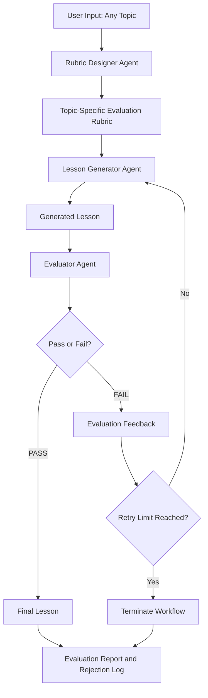

# 🎓 Self-Evaluating Lesson Content Generator

An agentic AI system that automatically generates beginner-friendly educational lessons on any topic, evaluates them against a dynamically designed quality rubric, and improves rejected content through an autonomous regeneration loop.

The system follows a **Generate → Evaluate → Regenerate → Finalize** workflow, ensuring that lessons meet predefined quality standards before being presented to the user.

## 🚀 Project Overview

Traditional AI content generation systems generate content based on a prompt and return the result without systematically verifying its quality.

This project addresses that limitation by introducing an autonomous evaluation mechanism.

Users can enter any topic, and the system:

1. Understands the requested topic.
2. Dynamically designs a topic-specific evaluation rubric.
3. Generates a beginner-friendly lesson.
4. Evaluates the lesson against the rubric.
5. Identifies missing information, inaccuracies, and quality issues.
6. Regenerates the lesson using evaluator feedback if it fails.
7. Returns the final evaluated lesson and execution report.

**Example input:** Introduction to Retrieval-Augmented Generation (RAG)

The system is not restricted to RAG. It can generate lessons on Python, Machine Learning, Artificial Intelligence, Economics, Geography, and other topics.

## 🏗️ System Architecture

The application uses a multi-agent architecture orchestrated through LangGraph.



## 🤖 AI Agents

### 1. Rubric Designer Agent

Creates a topic-specific evaluation rubric based on the user's input.

Responsibilities:
- Identifies the essential concepts of the topic.
- Defines measurable evaluation checkpoints.
- Establishes clear PASS/FAIL conditions.
- Ensures the rubric covers the expected learning outcomes.

### 2. Lesson Generator Agent

Generates a complete beginner-friendly lesson using the topic and evaluation rubric.

Responsibilities:
- Explains concepts using simple language.
- Introduces technical terminology with clear definitions.
- Provides practical examples and explanations.
- Organizes content in a logical learning sequence.
- Uses evaluator feedback to improve rejected lessons.

### 3. Evaluator Agent

Independently evaluates the generated lesson against the dynamically designed rubric.

Responsibilities:
- Checks factual accuracy and grounding.
- Evaluates beginner-friendliness and clarity.
- Identifies missing concepts.
- Checks the quality of examples.
- Evaluates logical flow and completeness.
- Provides specific feedback for failed checkpoints.

The evaluator follows a strict PASS/FAIL mechanism rather than assigning partial credit.

## 🔄 Self-Evaluation and Regeneration Loop

The system uses an autonomous feedback loop.

# Stage ->  Description 

 1. Generate -> Generator creates the initial lesson. 
 2. Evaluate -> Evaluator checks the lesson against every rubric criterion. 
 3. Pass -> Lesson is accepted if all required checks pass. 
 4. Fail -> Evaluator generates actionable feedback. 
 5.  Regenerate -> Generator improves the lesson using the feedback. 
 6.  Finalize -> Workflow terminates after passing or exhausting retries. 

**Retry configuration:**
- Initial generation: 1 attempt.
- Maximum retries: 2.
- Maximum generation attempts: 3.

The workflow terminates when the lesson passes evaluation or reaches the retry limit.

## 📋 Evaluation Criteria

The rubric is dynamically designed according to the selected topic.

In addition to topic-specific checkpoints, the evaluation considers universal teaching-quality dimensions:

- **Accuracy and Grounding:** Information must be factually correct and supported by available reference material.
- **Beginner-Friendly Language:** Concepts should be understandable to someone with no prior knowledge.
- **Conceptual Clarity:** Technical terminology must be explained.
- **Practical Examples:** Examples should help learners understand how concepts work.
- **Topic Coverage:** Essential concepts must be covered.
- **Logical Flow:** Content should progress in a structured and coherent manner.

Each checkpoint receives a PASS or FAIL result, along with its reason and supporting evidence.

## 🖥️ Streamlit User Interface

The project includes a Streamlit frontend for interactive demonstrations.

Features:
- Enter any topic.
- Optionally provide reference material.
- Start the autonomous generation workflow.
- View the generated lesson.
- Inspect the dynamically created evaluation rubric.
- Review individual PASS/FAIL evaluation results.
- Inspect rejection history and regeneration feedback.
- Download the final lesson and evaluation reports.

## 🛠️ Technology Stack

| Technology | Purpose |
|---|---|
| Python | Core development |
| LangGraph | Agent orchestration and workflow management |
| LangChain | LLM integration |
| Groq | Large Language Model inference |
| Pydantic | Structured evaluation outputs |
| Streamlit | Interactive frontend |
| Tavily | Web search and information retrieval (if configured) |

## 📁 Project Structure

```text
lesson-content-generator/
│
├── agents/
│   ├── __init__.py
│   ├── rubric_designer.py
│   ├── generator.py
│   └── evaluator.py
│
├── prompts/
│   ├── rubric_prompt.py
│   ├── generator_prompt.py
│   └── evaluator_prompt.py
│
├── evaluation/
│   └── rubric.py
│
├── graph/
│   ├── state.py
│   ├── nodes.py
│   └── workflow.py
│
├── outputs/
│
├── streamlit_app.py
├── main.py
├── config.py
├── requirements.txt
├── .env
├── .gitignore
└── README.md
```

## ⚙️ Installation and Setup

### 1. Clone the Repository

```bash
git clone https://github.com/YOUR_USERNAME/lesson-content-generator.git

cd lesson-content-generator
```

### 2. Create a Virtual Environment

```bash
python -m venv self_env
```

Activate it on Windows:

```bash
venv\Scripts\activate
```

On Linux/macOS:

```bash
source venv/bin/activate
```

### 3. Install Dependencies

```bash
pip install -r requirements.txt
```

### 4. Configure Environment Variables

Create a `.env` file in the project root.


GROQ_API_KEY=groq_api_key
TAVILY_API_KEY=tavily_api_key

Use the Tavily key only if web search is configured in your implementation.

Never upload your `.env` file or API keys to GitHub.

### 5. Run the Streamlit Application

```bash
streamlit run streamlit_app.py
```

The application will open in your browser, usually at:

```text
http://localhost:8501
```

## 📂 Generated Outputs

The application provides the following outputs:

| File | Description |
|---|---|
| `final_lesson.md` | Final generated lesson |
| `rubric.json` | Topic-specific evaluation rubric |
| `evaluation.json` | Detailed PASS/FAIL evaluation |
| `rejection_log.json` | Rejected attempts and evaluator feedback |
| `final_submission.md` | Complete project execution report |

The rejection log records what failed, why it failed, and what feedback was provided for regeneration.

If the initial lesson passes, the rejection log correctly indicates that no regeneration was required.

## 🎯 Example Use Cases

The system can generate lessons on different subjects:

- **Artificial Intelligence:** Introduction to RAG.
- **Programming:** Python Fundamentals.
- **Machine Learning:** Supervised vs. Unsupervised Learning.
- **Computer Science:** Operating Systems.
- **Economics:** Introduction to GDP.
- **Geography:** Atmospheric Circulation.

Each topic receives its own evaluation rubric instead of relying on a fixed RAG-specific checklist.

## 🔮 Future Enhancements

- Real-time agent execution tracking in Streamlit.
- Integration with trusted knowledge sources for stronger factual grounding.
- Persistent lesson and evaluation history.
- Advanced evaluation using multiple independent evaluators.
- Topic-specific difficulty levels.
- Export lessons to PDF and DOCX.
- Human review and approval before publishing.
- Support for multilingual lesson generation.

## 💡 Key Design Decisions

- **Dynamic Rubric Design:** Makes the system adaptable to any topic.
- **Separate Generator and Evaluator:** Reduces the risk of the generator judging its own output.
- **Strict PASS/FAIL Evaluation:** Ensures every mandatory criterion must be satisfied.
- **Bounded Regeneration:** Prevents infinite loops and uncontrolled LLM usage.
- **Feedback-Driven Improvement:** Gives the generator specific reasons for rejection rather than simply asking it to try again.
- **Modular Architecture:** Separates prompts, agents, evaluation logic, and workflow orchestration.

## 👨‍💻 Author

**Ranjesh Kumar Verma**

AI / Generative AI Developer

---

⭐ If you find this project interesting, consider starring the repository!